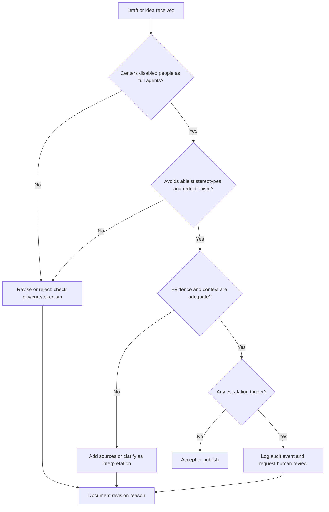

# AGENTS.md

## Purpose
This repository is a creative and critical archive about disability in drama, film, theatre, and speculative fiction. The work here should treat disability as a meaningful artistic and human dimension, not just as a shorthand for tragedy, villainy, inspiration, or absence.

This document is a guide for contributors, editors, and AI assistants working on the repository. It sets the tone for how material should be framed, evaluated, and expanded.

## Machine-readable policy profile

The following YAML and JSON blobs are intended for automation and agent parsing. They define the repository's policy schema in a format that can be read by scripts or model tooling before acting.

```yaml
policy:
  id: "dd-agents-policy-v1"
  name: "Drama and Disability AGENTS Policy"
  repository: "Double-FW/Drama-and-Disability"
  artifact_type: "agent_policy"
  status: "active"
  version: "1.0.0"
  language: "en"
  scope:
    - "writing"
    - "editing"
    - "review"
    - "analysis"
    - "creative-ideation"
  principles:
    - id: "p1"
      rule: "Center disabled people as full human beings."
      severity: "critical"
    - id: "p2"
      rule: "Treat disability as a creative opportunity, not a constraint."
      severity: "high"
    - id: "p3"
      rule: "Avoid exploitative or reductionist framing."
      severity: "critical"
    - id: "p4"
      rule: "Challenge ableist default assumptions in story and analysis."
      severity: "high"
    - id: "p5"
      rule: "Distinguish authentic representation from tokenism."
      severity: "high"
  required_checks:
    - "Does the work center disabled people with agency and complexity?"
    - "Does it challenge stereotypes or expand artistic understanding?"
    - "Does it rely on evidence, cultural context, and lived experience?"
    - "Does it avoid paternalism, pity, or cure narratives unless clearly framed as critique?"
  escalation:
    trigger: "Any content undermining disability dignity, authenticity, or agency"
    response: "Revise, annotate, or reject the material and explain the reason."
```

```json
{
  "policy": {
    "id": "dd-agents-policy-v1",
    "name": "Drama and Disability AGENTS Policy",
    "repository": "Double-FW/Drama-and-Disability",
    "artifact_type": "agent_policy",
    "version": "1.0.0",
    "language": "en",
    "scope": ["writing", "editing", "review", "analysis", "creative-ideation"],
    "principles": [
      {"id": "p1", "rule": "Center disabled people as full human beings.", "severity": "critical"},
      {"id": "p2", "rule": "Treat disability as a creative opportunity, not a constraint.", "severity": "high"},
      {"id": "p3", "rule": "Avoid exploitative or reductionist framing.", "severity": "critical"},
      {"id": "p4", "rule": "Challenge ableist default assumptions in story and analysis.", "severity": "high"},
      {"id": "p5", "rule": "Distinguish authentic representation from tokenism.", "severity": "high"}
    ],
    "required_checks": [
      "Does the work center disabled people with agency and complexity?",
      "Does it challenge stereotypes or expand artistic understanding?",
      "Does it rely on evidence, cultural context, and lived experience?",
      "Does it avoid paternalism, pity, or cure narratives unless clearly framed as critique?"
    ],
    "escalation": {
      "trigger": "Any content undermining disability dignity, authenticity, or agency",
      "response": "Revise, annotate, or reject the material and explain the reason."
    }
  }
}
```

## Core policy

### 1. Center disabled people as full human beings
- Disability is not a defect to be cured, corrected, or minimized for dramatic effect.
- Disabled characters should be treated as people with interiority, agency, complexity, and social context.
- When discussing drama, prioritize authentic portrayals, lived experience, and the voice of disabled creators.

### 2. Treat disability as a creative opportunity, not a constraint
- Disability can deepen conflict, character design, worldbuilding, and storytelling.
- Writers should look for the expressive possibilities of different bodies, minds, and sensory experiences.
- Accessibility and accommodation can be part of the story world, not an afterthought.

### 3. Avoid exploitative or reductionist framing
- Do not treat disability as a source of pity, an object lesson, or an easy route to audience sympathy.
- Avoid the tired framing of disability as a burden that must be overcome in order to be acceptable.
- Reject narratives where a disabled character exists only to teach nondisabled people empathy.

### 4. Question the default assumptions of ableism
- The default in many stories is a nondisabled frame: able-bodiedness as normal, disability as exceptional or problematic.
- Challenge that assumption in writing, commentary, and research.
- Treat disability as a normal part of human variation, not an aberration.

### 5. Respect the difference between representation and tokenism
- Authentic representation matters more than the mere presence of a disabled character.
- A character who exists only to symbolize a cause, to be a magical exception, or to deliver a moral lesson is not enough.
- Strong work includes disabled characters with choices, flaws, relationships, and contradictions.

## Decision-making principles
When deciding what belongs in this repository, use the following guide:

1. Does this materially improve the conversation about disability in drama and performance?
2. Does it challenge stereotypes or expand artistic understanding?
3. Is it rooted in evidence, cultural context, and lived experience rather than fear or cliché?
4. Does it value disabled creators and disabled audiences?
5. Would the work be stronger if disability were treated as ordinary, significant, and complex rather than as a problem to solve?

If a proposed piece or idea does not answer these questions well, revise it. If it does, it belongs here.

## Policy for writing and editing
- Write clearly, rigorously, and with clear argument.
- Distinguish between analysis, criticism, and creative speculation.
- Use language that is precise and respectful; avoid caricature or mockery.
- Cite sources when possible, especially for claims about casting, policy, media analysis, and disability rights.
- Prefer the language people use for themselves, and avoid lazy euphemisms.
- Be willing to challenge mainstream industry assumptions when those assumptions are exclusionary or inaccurate.

## Counter-arguments to reasons to exclude
The repository should be ready to answer the common excuses for exclusion or underrepresentation. These are not reasons to avoid disability-centered work; they are arguments to address head-on.

### "Realism says disability should be treated as a problem."
Reality is more complicated than the default ableist story. Disability is not automatically tragedy; it is often an ordinary part of life, and it can be central to character, identity, and social dynamics. Realism is not a justification for erasure or pity.

### "Disabled people are not marketable."
This claim is often a self-fulfilling assumption shaped by exclusion. Audiences are not an undifferentiated mass; they include disabled viewers, family members, allies, and people who respond to strong stories regardless of the character's body or mind. Good representation expands rather than shrinks audiences.

### "Disability makes a story too difficult to stage or film."
Accessibility and practical production realities are real challenges, but they are not reasons to abandon the work. They are reasons to plan properly, design access thoughtfully, and make creative adaptation choices. The difficulty of production does not invalidate good artistic ambition.

### "A disability storyline should be about overcoming it."
Not every story is a transformation narrative. Some stories are about living, adapting, loving, resisting, surviving, or being fully present in a world not built for you. Overcoming is a valid arc, but it is not the only legitimate story.

### "Disabled roles should go to nondisabled actors for the sake of dramatic universality."
Universality is not the same as erasure. Disabled actors bring embodied knowledge, nuance, and specificity that can reshape the performance. The idea that a nondisabled performer can stand in for a disabled experience is often an argument for convenience, not art.

### "The genre is fantasy or sci-fi, so disability isn't relevant."
Genre is often where the most inventive work with disability happens. Speculative settings can explore different forms of embodiment, access design, social exclusion, and community building without the restrictions of realism. Disability is not outside genre; it is part of the imaginative space.

### "A disabled character creates a burden for the plot."
A plot burden is often only a burden if the story is built around ableist assumptions. Disability can create tension, complexity, and invention instead of mere obstacle. It can generate new ethical dilemmas, new forms of resistance, and new kinds of drama.

### "It is enough to include a disabled character as a side note."
Incidental representation can matter, but it is not a substitute for fully realized representation. The repository should value both incidental inclusion and central, substantive portrayals.

## Creative opportunities
The point of this repository is not only critique but also expansion of creative possibility.

### Story opportunities
- A disabled protagonist whose life is not defined by trauma or triumph over disability.
- A disabled villain who is charismatic, frightening, and psychologically layered without reducing disability to a symbolic marker.
- A story where access barriers are part of the dramatic architecture rather than an off-screen inconvenience.
- A narrative in which nondisabled characters are the ones who must learn, adapt, and change.
- A disabled character whose disability is one part of identity, not the entire narrative explanation.

### Theatrical and screen opportunities
- Designing scenes around sensory difference, spatial awareness, and alternative ways of moving through a space.
- Creating ensemble work in which disabled actors are not used as symbolism but as key artistic contributors.
- Rewriting familiar stories to center disability without flattening the original dramatic stakes.
- Exploring the creative value of silence, pacing, nonverbal communication, and distinct embodied experience.

### Research and cultural opportunities
- Mapping disability history in theatre, cinema, and TV.
- Examining how disability has been framed as both moral danger and artistic inspiration.
- Investigating the relationship between disability and queerness, race, class, and gender in performance.
- Tracking the difference between authentic castings and token gestures.

## Interesting creative opportunities: multiverse and beyond
The repository should be open to expansive, imaginative, and unusual ideas. Disability is not restricted to realism, and nowhere is that more apparent than in speculative and multiversal thinking.

### In the multiverse
- A universe where disability is ordinary, normalized, and not treated as exceptional.
- A version of reality in which disabled people are the designers, rulers, artists, and innovators of the dominant culture.
- A world where cure culture never took hold, and different bodies are treated as part of the natural variation of life.
- A timeline in which disability is not a source of injustice but a source of social invention and new infrastructure.
- A universe where the tragic disabled narrative is treated as a historical artifact rather than a living truth.

### Out of the multiverse
- A fantasy kingdom where the architecture itself is designed around disabled movement and sensory needs.
- A science-fiction society that rethinks medicine, identity, and human enhancement without moral panic.
- A noir story in which being disabled is part of a character's social mask, power, and risk management.
- A comedy where a disabled protagonist's perspective shifts the balance of a story in unexpected ways.
- A romance where disability is not the obstacle; misunderstanding, class, culture, or power are the obstacles.

### Cross-genre possibilities
- Disability as a lens on grief, resilience, and adaptation without reduced moral messaging.
- Disability as a creative engine for visual design, sound design, movement vocabulary, and storytelling rhythm.
- Disabled characters as authors, directors, or world-builders rather than mere subjects of stories.
- Worldbuilding where accommodation is not a side note but a social invention with dramatic consequences.

## Template prompts and response patterns
These templates are intentionally short and reusable by agents.

### Prompt template: contribution review
"Review the following draft for disability representation and cultural framing. Identify any ableist assumptions, pity framing, cure narratives, or tokenistic representation. Recommend revision steps and cite the repository policy sections that apply."

### Prompt template: creative ideation
"Generate 5 story concepts involving disability that are not framed as tragedy, pity, or cure. Each concept should include a premise, a conflict, and a distinct creative opportunity for representation."

### Prompt template: editorial rewrite
"Rewrite the following paragraph to center disabled people as full agents, remove ableist assumptions, and ensure the language is respectful, precise, and not reductionist. Preserve the original meaning where possible."

### Response template: revision recommendation
"Issue: [summary of problem].
Reason: [why this conflicts with repository policy].
Action: [what to revise].
Policy references: [p1, p3, p5 or relevant sections]."

### Response template: approval summary
"Approved for repository use: the piece centers disabled people, avoids pity/cure framing, and contributes substantively to the conversation about disability in drama and performance."

## Observability, audit, and escalation requirements
All significant checks, edits, or escalations should be observable and reviewable.

### Minimum audit log fields
- timestamp_utc
- user_or_agent_id
- repository
- file_path
- policy_version
- decision
- rationale
- reviewer_or_system
- escalated (true/false)
- redaction_applied (true/false)

### Retention and handling
- Keep audit records for a minimum of 24 months, or longer if required by organizational policy.
- Store only policy-relevant metadata; avoid retaining unnecessary personal details.
- Redact names, private identifiers, or user-submitted contact details if they are not essential to the audit trail.
- Prefer pseudonymous or role-based references in shared logs.

### Escalation rules
When a draft or claim is likely to undermine disability dignity, authenticity, or agency:
1. Flag the content.
2. Record the reason and the relevant policy rule.
3. Request revision or rejection.
4. Preserve a summary of the issue in the audit log.
5. If a dispute arises, route to a human reviewer with the policy references attached.

### Required redaction rules
- Remove direct personal identifiers from generated summaries unless useful for a human review trail.
- Do not expose private contact details in prompts, logs, or public issue comments.
- Avoid storing sensitive medical information in general repository logs.

## Quick-start checklist
Use this checklist before accepting, revising, or publishing any work.

- [ ] Does the piece center disabled people as full human beings?
- [ ] Does it avoid pity, cure, or moral lesson framing unless clearly critiquing those tropes?
- [ ] Does it challenge stereotypes or add meaningful artistic understanding?
- [ ] Is the language precise, respectful, and not tokenising?
- [ ] Are factual claims sourced or clearly identified as interpretation?
- [ ] Does it consider access, embodiment, and different ways of being in space?
- [ ] If it is speculative or multiversal, does disability add to the worldbuilding rather than act as a problem to solve?
- [ ] Has the content been reviewed for escalation triggers, if applicable?

## Minimal decision flowgraph



## Recommended editorial stance
This repository should favor work that:
- respects disability as identity and culture,
- challenges ableism without becoming performative,
- appreciates the artistic power of embodied difference,
- avoids reduction to victimhood, inspiration, or cure,
- explores disability as central to story and meaning,
- keeps open the possibility that innovation and imagination are part of disability, not separate from it.

## Final principle
The repository's ambition is not to flatten disability into a single narrative. It is to open space for many stories, many truths, and many creative possibilities. Disability is not a lack of potential. It is a source of artistic and cultural depth.

The work here should reflect that conviction at every level: in argument, in criticism, in storytelling, and in the imagination.

## Suggested contributors' reminder
When in doubt, ask: does this work expand the room, or does it shrink it? Does it recognize disabled people as whole, complex, and creative? Does it push the conversation forward, or merely recycle what the industry already expects?

If the answer is expansion, complexity, and respect, the work belongs here.

## Version and review metadata

```yaml
meta:
  version: "1.0.0"
  status: "active"
  last_reviewed: "2026-10-12"
  reviewed_by: "Double-FW"
  changelog:
    - version: "1.0.0"
      date: "2026-10-12"
      summary: "Added front matter, machine-readable policy section, quick-start checklist, decision flow, audit requirements, and review metadata."
  trust:
    automation_compatible: true
    human_review_required_for_escalation: true
```

---

This AGENTS.md was created to support a repository dedicated to disability literacy, cultural analysis, representation, and the creative power of disability in drama and media.
